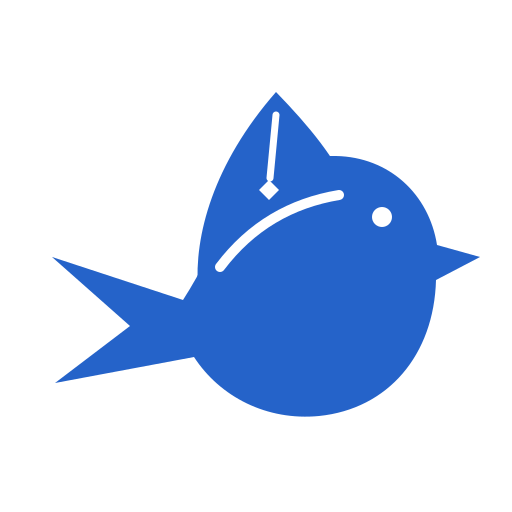
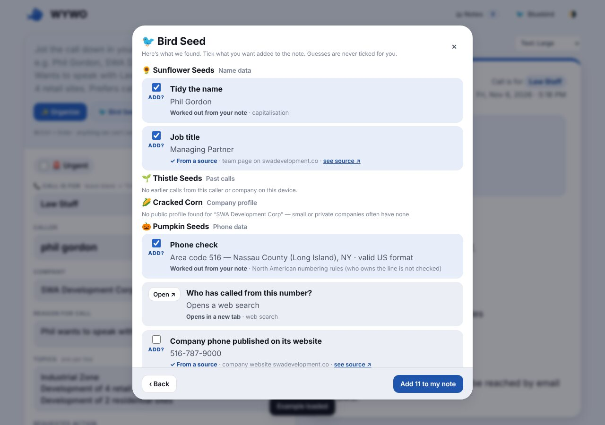
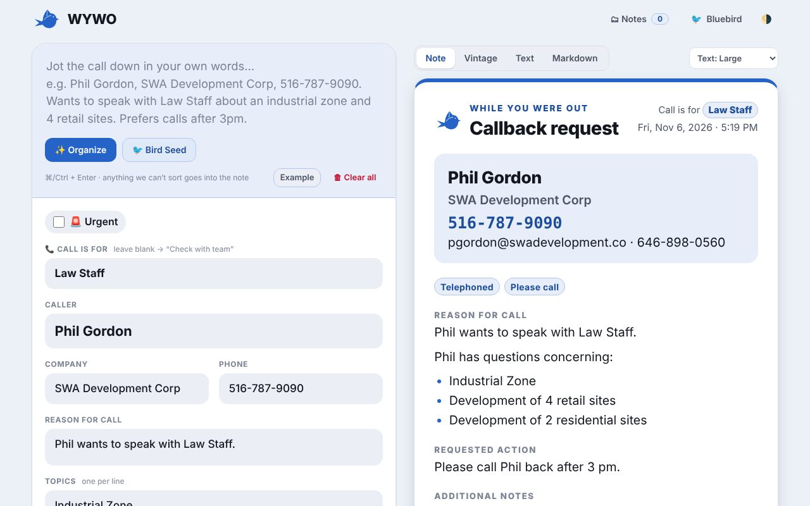
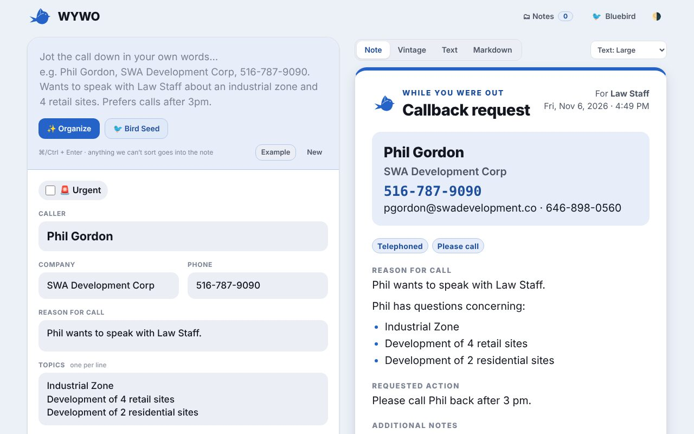
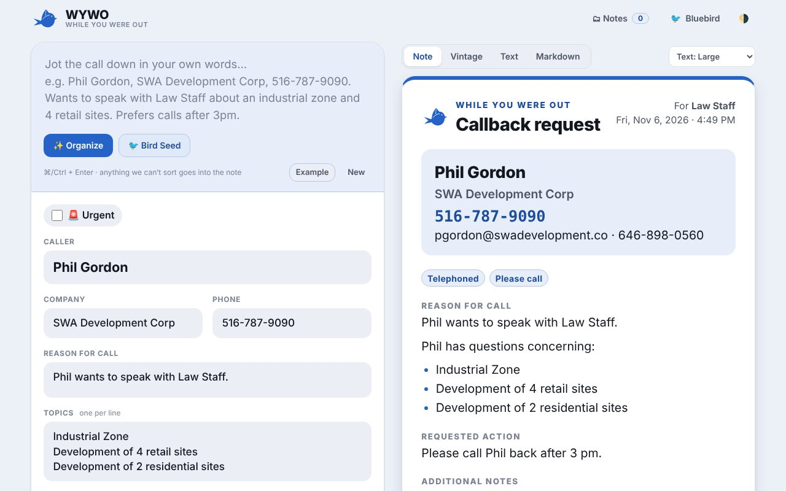
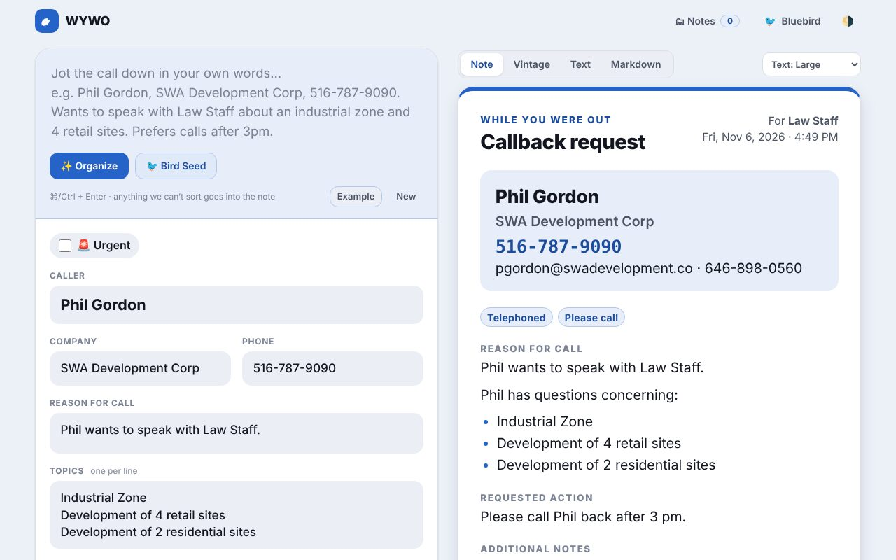
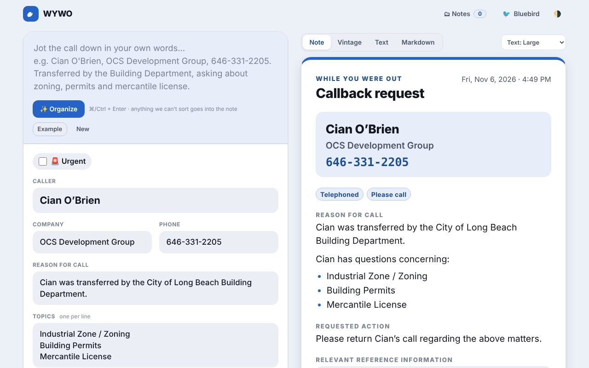
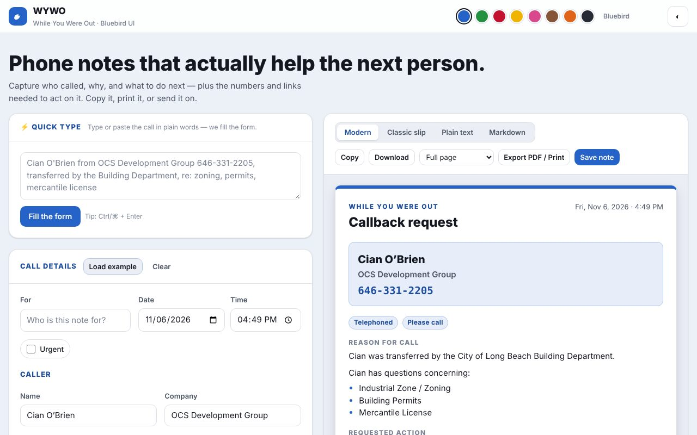

<div align="center">



# WYWO — While You Were Out

**Turn a quick phone call into a clear, detailed, printable callback note.**
Built for office staff, municipal staff, and anyone who transfers calls.

Powered by **Bluebird UI** — a tiny, themeable design system with 8 bird themes.

[](CHANGELOG.md)
[](https://github.com/Sukonik/wywo/actions/workflows/pages.yml)
[](LICENSE)

[🌐 **Live site**](https://sukonik.github.io/wywo/) · [📦 **Repository**](https://github.com/Sukonik/wywo) · [📝 **Changelog**](CHANGELOG.md) · [🐛 **Report an issue**](https://github.com/Sukonik/wywo/issues)

</div>

---

## 🔗 Links

| | |
|---|---|
| 🌐 Live website | https://sukonik.github.io/wywo/ |
| 📦 Source code | https://github.com/Sukonik/wywo |
| 🔄 Deploys / versions | https://github.com/Sukonik/wywo/actions |
| 🐦 Design system | [`bluebird-ui/bluebird.css`](bluebird-ui/bluebird.css) |
| 🏛️ Sister project (style inspiration) | https://github.com/Sukonik/GoldenSunLaw |

## 🧭 Emoji guide

Every emoji in the app and this README means the same thing everywhere.

| Emoji | Meaning | Where you'll see it |
|---|---|---|
| 📞 | The call / the note itself | Title, Markdown export |
| ⚡ | **Quick type** — plain words → filled form | Top card in the app |
| 🐦 | **Bird Seed**: look up real info, then ask before adding | Quick type bar |
| 🛠 | Look-up engine (free reader · Firecrawl · Crawl4AI · ScrapeGraphAI) | Bird Seed window |
| 🌰 | Select all seeds | Bird Seed |
| 🌻🌱🌽🎃🌾🥬🍉🌶️🥒🍈 | The 10 seeds: name · past calls · company profile · phone · email · website · LinkedIn · city departments · address · summary | Bird Seed |
| ＋ | Add a reference or item | Buttons |
| 🖨️ | Export PDF / Print | Preview toolbar |
| 💾 | Save note (on this device only) | Saved notes |
| 🌗 | Light / dark mode | Header |
| 🗂 | Saved notes drawer | Header |
| ✨ | Organize — sort what you typed into fields | Quick type |
| 🎨 | Bluebird UI themes | Theme menu |
| 🪶 | The WYWO bluebird logo | Header, footer, printed note |
| 🌲 | App icon (Cedar, Pine, Maple, Hazelnut, Linden, Beech) | Tab, home screen, Theme → App icon |
| 🔄 | Automatic merge & publish | Workflows |
| 🔒 | Privacy — stays in your browser | Footer / README |
| 🚨 | Urgent call | Urgent flag (red badge) |
| 📞 | **Call is for** — who the call is routed to (blank → “Check with team”) | Top of the form; every view and printout |
| 🗑 | Clear all fields (asks “Yes, I’m sure” first) | Quick type bar |
| ✅ | Checked call type (Telephoned, Please call…) | Classic slip |

**Quick workflow:** ⚡ type it → 🐦 Bird Seed the gaps → 🖨️ export → 💾 save.

## ✨ What it does

| | |
|---|---|
| ⚡ **Quick type** | Type or paste the call in plain words — *"call Phil Gordon 5167879090 SWA Development Corp, Industrial Zone, wants to speak to Law Staff, questions about development of 4 retail sites… email pgordon@swadevelopment.co… prefers calls after 3pm"* — and the form fills itself. **Nothing is dropped:** anything that can't be sorted goes into *Additional notes* and prints with the note. |
| 🐦 **Bird Seed** | Looks up missing or relevant info (names, phones, emails, websites, LinkedIn, addresses, city departments) from real sources and **asks before adding it**. See [Bird Seed](#-bird-seed). |
| 🖨️ **Export PDF / Print** | Pick **Full page**, **Pad slip (4¼ × 5½ in)** or **2 per sheet**, press *Export PDF / Print*, choose **Save as PDF** (or your printer). |
| 🗒️ **Four views** | **Note**, **Vintage** slip that mirrors the paper pad, **Plain text**, and **Markdown** — copy or download any of them. |
| 💾 **Saved notes** | Notes are saved locally in your browser (nothing is uploaded). Re-open or delete them any time. |
| 🔠 **Large, readable text** | Large by default (Standard / Large / Extra large), applied to every view and printout. The Vintage slip uses a clean calligraphy hand (Dancing Script) instead of scratchy handwriting. |
| 🗂 **Notes drawer** | Saved notes as simple cards, one click to reopen. |
| 🌗 **Light / dark + 8 themes** | Responsive from phone to desktop. |

### Example output

```
WHILE YOU WERE OUT

CALLBACK REQUEST

FOR: Law Staff

CALLER: Phil Gordon
COMPANY: SWA Development Corp
PHONE: 516-787-9090
ALSO: pgordon@swadevelopment.co · 646-898-0560

REASON FOR CALL
Phil wants to speak with Law Staff.
Phil has questions concerning:
Industrial Zone
Development of 4 retail sites
Development of 2 residential sites

REQUESTED ACTION
Please call Phil back after 3 pm.

ADDITIONAL NOTES
Prefers calls after 3 pm. Can also be reached by email or SMS.

RELEVANT REFERENCE INFORMATION
SWA Development Corp
Company website
https://swadevelopment.co
```

Press **Load example** in the app to see the full version.

## 🐦 Bluebird UI themes

| Theme | Colour | `data-theme` |
|---|---|---|
| Bluebird | blue | `bluebird` |
| Monk Parakeet | green | `parakeet` |
| Cardinal | red | `cardinal` |
| Goldfinch | yellow | `goldfinch` |
| Roseate Spoonbill | pink | `spoonbill` |
| Song Sparrow | brown | `sparrow` |
| American Robin | orange | `robin` |
| Night-Heron | black | `heron` |

Each theme ships light and dark variants (`data-mode="light|dark"`, or follows the OS). All colours derive from one brand colour per theme, so adding a ninth bird is one line in [`bluebird-ui/bluebird.css`](bluebird-ui/bluebird.css).

Components: container, card, button (primary / ghost / danger / icon), input / textarea / select, check chips, tabs, badges, swatches, toast.

```html
<html data-theme="cardinal" data-mode="dark">
  <link rel="stylesheet" href="bluebird-ui/bluebird.css">
  <button class="bb-btn bb-btn--primary">Save</button>
```

## 🚀 Run it

No build step, no dependencies. Open `index.html`, or:

```bash
python3 -m http.server 8080
```

## 🔄 Automatic merge & publish

Every new version is shipped automatically:

1. Push to a `claude/**` branch.
2. [`auto-merge.yml`](.github/workflows/auto-merge.yml) opens a PR into `main` and squash-merges it.
3. [`pages.yml`](.github/workflows/pages.yml) deploys the site to **GitHub Pages**, stamping the commit hash into the footer.

**One-time setup (repo owner):**
- *Settings → Pages → Source:* **GitHub Actions**
- *Settings → Actions → General → Workflow permissions:* **Read and write**, and tick **Allow GitHub Actions to create and approve pull requests**

## 🐦 Bird Seed

**Bird Seed finds missing or relevant information for a call, shows you what it found and where it came from, and asks before adding anything.** Nothing goes into the note unless you tick it.

**How to use it:** press **🐦 Bird Seed** → tick the seeds you want (or **🌰 Select all**) → **🌱 Scatter seeds** → review → **Add**. Ticked items land in the right place: a field, *Additional notes*, or *References*, so they print with the note.

Every finding is labelled:
- ✓ **From a source**: read from a real page, record or your own notes (with a **see source ↗** link)
- **Worked out from your note**: computed from what you typed
- **Guess, confirm first**: plausible but unconfirmed; **never pre-ticked**

### The ten seeds

| Seed | Looks up | Where it comes from |
|---|---|---|
| 🌻 **Sunflower Seeds** (*Name data*) | Tidies the name (`phil gordon` → `Phil Gordon`), finds the **full name and job title** | Company website team pages · email address · your earlier notes |
| 🌱 **Thistle Seeds** (*Past calls*) | Earlier calls, topics, and missing details from them | Your saved notes |
| 🌽 **Cracked Corn** (*Company profile*) | Public profile, HQ and official website | Wikidata |
| 🎃 **Pumpkin Seeds** (*Phone data*) | Format, region, invalid / fictional numbers (`555-01xx`), **does it match the company’s published number?**, other company numbers | Numbering rules · company website |
| 🌾 **Flax Seed** (*Email data*) | The caller’s **email on the company site**, general company emails, whether the email domain really accepts mail, the company’s email pattern | Company website · public DNS |
| 🥬 **Kale Seeds** (*Website data*) | The **real company website**, its description and contact page | Email domain · DNS · the site itself |
| 🍉 **Watermelon Seeds** (*LinkedIn & social*) | **LinkedIn company page**, the caller’s LinkedIn profile, Facebook / Instagram / X / YouTube | Links published on the company site (guess + search links if none) |
| 🌶️ **Pepper Seeds** (*City departments*) | **Verified Long Beach, NY departments** with phone, room and link for the call topics | [`src/directory.js`](src/directory.js), copied from longbeachny.gov |
| 🥒 **Cucumber Seeds** (*Address data*) | The business **street address**, checked on a map | Company website · OpenStreetMap |
| 🍈 **Honeydew Seeds** (*Company summary*) | A short “about” blurb and what the site highlights | Company website |

### Look-up engines (how websites get read)

The website seeds (🌻 🎃 🌾 🥬 🍉 🥒 🍈) read the company’s own site and its team / contact / about pages. Choose the engine in **Bird Seed → 🛠 Look-up engine**:

| Engine | Cost | How |
|---|---|---|
| **Built-in reader** (default) | Free, no key | [Jina Reader](https://r.jina.ai) fetches the page. Works out of the box |
| [**Firecrawl**](https://github.com/firecrawl/firecrawl) | Your API key | `POST https://api.firecrawl.dev/v2/scrape` |
| [**Crawl4AI**](https://github.com/unclecode/crawl4ai) | Your key (cloud) or your own server | cloud `POST https://api.crawl4ai.com/scrape` · self-hosted `POST <your server>/md` |
| [**ScrapeGraphAI**](https://github.com/ScrapeGraphAI/Scrapegraph-ai) | Your API key | `POST https://v2-api.scrapegraphai.com/api/extract` with a prompt, so AI pulls the contact details |

> 🧪 **Status:** the built-in reader is tested against real websites. The three optional engines send the requests described in each project’s own docs and are tested with simulated responses, so they are **beta** until tried with a real key.

### Privacy and limits
- Your **API keys are stored only in this browser** and sent only to that service. Never put a key in the page or the repo.
- Only the **company website address** (or a name / email domain for DNS and Wikidata) leaves your browser, never the whole note.
- Some sites block automated readers, publish no address, or have no team page; Bird Seed says so instead of guessing.
- LinkedIn can’t be read directly, so LinkedIn results come from links on the company’s own site; otherwise you get a guess plus search links.
- Always glance at **see source ↗** for anything you’re going to rely on.

## 🌲 Favicons 2.0 & logo

The WYWO bluebird (pen-nib wing, paper-fold tail) is the brand mark. It appears in the header, footer and printed note, recoloured by the colour theme.

Six botanical app icons wrap the same black bluebird: **Cedar** (default), **Pine**, **Maple**, **Hazelnut**, **Linden**, **Beech**.

| Where | What |
|---|---|
| Browser tab | `favicon.ico`, `favicon-16x16.png`, `favicon-32x32.png` (Cedar by default) |
| Phone home screen | `apple-touch-icon.png`, `android-chrome-192x192.png`, `android-chrome-512x512.png`, `site.webmanifest` |
| Pick another icon | **Theme menu → App icon**. It changes the tab and home-screen icon and is remembered on this device |
| All six, every size | [`assets/icons/<tree>/`](assets/icons/) (16 · 32 · 48 · `.ico` · 180 touch · 192 · 512) |

👀 **See them all:** [`assets/icons/index.html`](assets/icons/index.html) (live: https://sukonik.github.io/wywo/assets/icons/)

The icons already include their own rounded styling, so don’t add borders or shadows. iOS applies its own mask: test on a device before an App Store release (the 1024 px Cedar source is `assets/icons/cedar/app-icon-1024.png`). The logo’s source SVGs are in [`assets/logo/`](assets/logo/).

## 🕰️ Website version history

How the site has grown: seven releases so far. Each screenshot is the real site at that version, with the example note loaded. Full details in the [Changelog](CHANGELOG.md).

Current version: **0.7.0**. Every merge to `main` publishes automatically, and the footer shows the build hash of what you’re running (`v0.7.0 · build a1b2c3d`).

| | Version | What changed |
|---|---|---|
|  | **v7 · 0.7.0** 🐦<br>Bird Seed 2.0 | Ten real look-up seeds that read the company’s own website (free reader, or **Firecrawl / Crawl4AI / ScrapeGraphAI** with your key), then **ask you** before adding names, phones, emails, websites, LinkedIn, addresses and summaries |
|  | **v6 · 0.6.0** 📞<br>Call is for | **Call is for** always on every note (“Check with team” when unknown), routing phrases in Quick type, 🗑 **Clear all** with an “Are you sure?” checkbox |
|  | **v5 · 0.5.0 – 0.5.1** 🌲<br>Favicons 2.0 | Six botanical tree app icons (🌲 Cedar default, Pine, Maple, Hazelnut, Linden, Beech) with a **Theme → App icon** picker, installable web-app manifest, and a clean “WYWO” header |
|  | **v4 · 0.4.0** 🪶<br>Icons 2.0 | The WYWO bluebird logo in the header, footer and printed note, recoloured by theme; themed favicons; deploy fix so site assets publish |
|  | **v3 · 0.3.0 – 0.3.1** 🐦<br>Bird Seed | **Bird Seed**: 8 seeds that suggest names, phone checks, emails, websites, LinkedIn, verified Long Beach, NY departments, company profiles and past calls; new Phil Gordon sample; smarter Quick type |
|  | **v2 · 0.2.0** ✨<br>Calm redesign | Keep × Apple Notes style editor, **nothing lost** in Quick type (leftovers → Additional notes), calligraphy Vintage slip, larger text by default, saved-notes drawer |
|  | **v1 · 0.1.0** 🚀<br>First release | Bluebird UI with 8 bird themes, Quick type, lookups, Modern / Classic / Text / Markdown views, PDF export layouts, auto-publish |

**Releasing a new version:** bump the version in this README and [`CHANGELOG.md`](CHANGELOG.md), push to a `claude/**` branch and the workflows merge and publish it.

## 🔒 Privacy

Everything runs in your browser. Drafts, saved notes and any API keys live in `localStorage` on your device. The only network calls are the optional **Bird Seed** look-ups (see [Bird Seed](#-bird-seed)): they send a company website address, name or email domain to the reader/engine you chose, public DNS, Wikidata or OpenStreetMap, **never the whole note**. Always verify looked-up details before relying on them.

## 🗂️ Project layout

```
index.html            app shell
bluebird-ui/          design system (tokens, 8 themes, components)
src/app.css           app layout + print styles
assets/logo/          logo source SVGs (mark, favicon, app icon)
assets/icons/         six tree icons × every size (+ index.html board)
favicon*.png / .ico, apple-touch-icon.png, android-chrome-*.png, site.webmanifest   Cedar defaults
src/app.js            form, quick-type parser, Bird Seed UI, renderers, export
src/birdseed.js       Bird Seed engine (10 seeds + look-up engines)
src/directory.js      verified Long Beach, NY department directory
.github/workflows/    auto-merge + Pages publish
```

## 📄 License

See [LICENSE](LICENSE).
